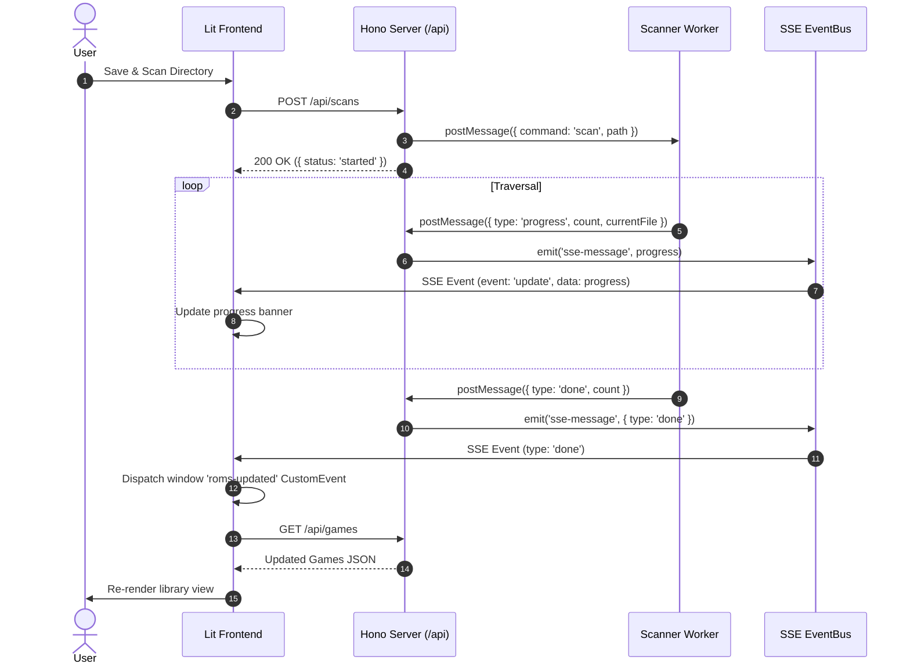

# System Architecture

This document describes the technical architecture, threading model, data flow, and subsystems of **Romanager**.

---

## 1. Architectural Overview

Romanager uses a client-server architecture with background workers, designed to run self-hosted as a unified binary or service.

```mermaid
graph TB
    subgraph Client ["Client (Browser)"]
        UI["Lit SPA (apps/ui)"]
        Components["Shared UI Components (@repo/ui-components)"]
        SSEListener["SSE Event Listener"]
    end

    subgraph Server ["Backend Server (apps/api)"]
        HonoApp["Hono HTTP Router"]
        WebDAVMount["WebDAV Server (/webdav)"]
        EventBus["EventEmitter EventBus"]
        
        subgraph Workers ["Deno Web Workers"]
            ScanWorker["Scanner Worker (workers/scanner.ts)"]
            DelWorker["Deletion Worker (workers/deletion.worker.ts)"]
        end
        
        subgraph Storage ["Data & Storage"]
            Drizzle["Drizzle ORM"]
            LibSQL["LibSQL / SQLite (romanager.db)"]
            DiskStorage["Physical ROM Directory"]
        end
    end

    subgraph External ["External Services"]
        RAWG["RAWG Video Games API"]
    end

    UI --> |REST API Requests| HonoApp
    SSEListener <--> |Server-Sent Events (/api/events)| HonoApp
    UI --> |Open in Browser| WebDAVMount
    
    HonoApp --> |Dispatch Task| ScanWorker
    HonoApp --> |Dispatch Task| DelWorker
    HonoApp --> |Read/Write| Drizzle
    HonoApp --> |Query Metadata| RAWG
    
    WebDAVMount --> |Direct File I/O| DiskStorage
    ScanWorker --> |Recursive Walk| DiskStorage
    DelWorker --> |Deno.remove| DiskStorage
    
    Drizzle --> LibSQL
    ScanWorker --> |Stage Scanned Files| Drizzle
    ScanWorker --> |Emit Progress| EventBus
    EventBus --> |Push Update| SSEListener
```

---

## 2. Monorepo Structure

Romanager is structured as a pnpm monorepo workspace configured in [`pnpm-workspace.yaml`](../pnpm-workspace.yaml) and [`package.json`](../package.json):

```
Romanager/
├── apps/
│   ├── api/                     # Backend application (Hono, Drizzle, WebDAV)
│   │   ├── main.ts              # Server entry point & environment loading
│   │   ├── drizzle.config.ts    # Drizzle Kit configuration
│   │   └── src/
│   │       ├── app.ts           # Hono server factory & route registration
│   │       ├── sse.ts           # EventBus EventEmitter instance
│   │       ├── webdav.ts        # Embedded WebDAV handler
│   │       ├── scanner.ts       # Directory crawler logic
│   │       ├── metadata.ts      # RAWG API client
│   │       ├── utils.ts         # Crypto hashing and slug generation
│   │       ├── worker.ts        # Deletion worker singleton manager
│   │       ├── db/              # Database initialization, schema, and queries
│   │       ├── routes/          # Modular API route handlers
│   │       └── workers/         # Node.js Worker thread scripts
│   ├── ui/                      # Frontend Single Page Application (Lit, Vite)
│   │   ├── vite.config.ts       # Vite configuration
│   │   └── src/
│   │       ├── index.html       # HTML root with theme fonts
│   │       ├── index.ts         # Application bootstrap & entry point
│   │       ├── global/          # Open Props global styles (app.css)
│   │       └── components/      # Lit Web Components & pages
│   └── cli/                     # CLI Companion Daemon (Single Executable Application)
│       ├── sea-config.json      # Node.js SEA configuration
│       └── src/
├── packages/
│   ├── shared/                  # Cross-boundary TypeScript definitions & Zod schemas
│   │   ├── types.ts             # Data models & schemas (Game, Rom, System, etc.)
│   │   └── utils.ts             # Path normalizers and schema validators
│   └── ui-components/           # Reusable Lit web component library
│       └── src/                 # data-table, game-card, ui-dialog, ui-tabs, ui-toast
├── tests/                       # Test suites
│   ├── api/                     # Vitest API contract tests
│   ├── unit/                    # Unit tests for API, shared utils, CLI, and UI
│   ├── features/                # Cucumber Gherkin feature definitions
│   └── steps/                   # Playwright-BDD step definitions
├── pnpm-workspace.yaml          # Monorepo workspace configuration
├── package.json                 # Monorepo scripts and devDependencies
└── roms/                        # Default ROM storage directory
```

---

## 3. Concurrency & Web Worker Architecture

To keep the HTTP server fast and responsive, time-consuming file I/O operations are offloaded to dedicated Deno Web Workers:

### 1. Scanner Worker (`apps/api/src/workers/scanner.ts`)
- **Command Dispatch**: Triggered by a POST request to `/api/scans` or `/api/settings` when `roms_dir` is updated.
- **Message Loop**:
  ```typescript
  // Message payload sent from main thread:
  worker.postMessage({ command: 'scan', path: '/path/to/roms' });
  ```
- **Progress Reporting**: Emits progress updates back to the parent thread:
  - `{ type: 'start' }`
  - `{ type: 'progress', count: 142, currentFile: 'zelda.z64' }`
  - `{ type: 'done', count: 500 }`
  - `{ type: 'error', message: 'Directory not found' }`

### 2. Deletion Worker (`apps/api/src/workers/deletion.worker.ts`)
- **Isolation**: Physical disk deletions (`Deno.remove`) run independently of the database transactions.
- **Resilience**: If a file was already removed manually on disk, the worker catches `Deno.errors.NotFound` without breaking the deletion queue.
- **Two-Phase Confirmation**:
  1. Main thread marks ROM record with `pendingDelete: true` and dispatches paths to the worker.
  2. Worker deletes files on disk and posts `{ type: 'ROM_DELETED', id }`.
  3. Main thread catches the message and executes `db.delete(roms).where(eq(roms.id, id))`.

---

## 4. Real-Time Event Bus & SSE Flow

Romanager implements Server-Sent Events (SSE) to deliver real-time feedback without polling:



---

## 5. WebDAV Subsystem

Romanager embeds a WebDAV server using `@smallweb/webdav`:

- **Path Mapping**: Mounted on `/webdav`. Incoming requests map the URI path directly into the configured `romsDir` on the host machine.
- **Protocol Compliance**: Handles standard WebDAV methods: `OPTIONS`, `PROPFIND`, `GET`, `HEAD`, `PUT`, `DELETE`, `MKCOL`, `MOVE`, and `COPY`.
- **Zero Configuration**: Devices simply point to `http://<host>:8000/webdav` to browse or stream ROMs.

---

## 6. Frontend Architecture (Lit & Open Props)

The user interface is an SPA constructed with modern Web Components:

- **Component Engine**: [Lit](https://lit.dev) 3.x providing reactive state (`@state()`), declarative HTML templating (`html`), and scoped CSS (`css`).
- **Client-Side Router**: `@lit-labs/router` inside `<app-root>` routing between:
  - `/` -> `<app-library>`
  - `/game/:gameSlug` -> `<app-game-detail>`
  - `/add` -> `<app-add-game>`
  - `/unmapped` -> `<app-unmapped>`
  - `/settings` -> `<app-settings>`
  - `/settings/rom-management` -> `<app-settings-roms>`
  - `/settings/platforms` -> `<app-settings-platforms>`
  - `/play/:gameId` -> `<app-emulator>`
- **Design Tokens**: Leverages **Open Props** for CSS custom properties (colors, typography, spacing, shadows, and easing transitions).
