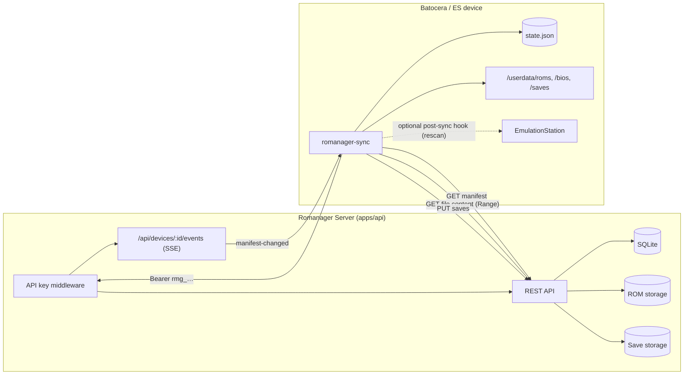
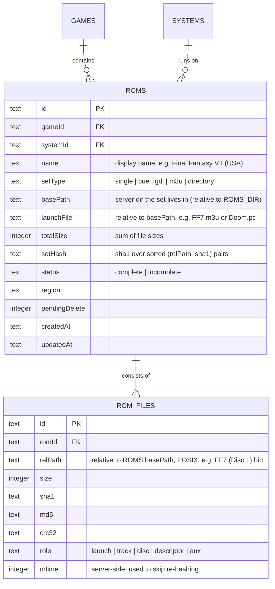
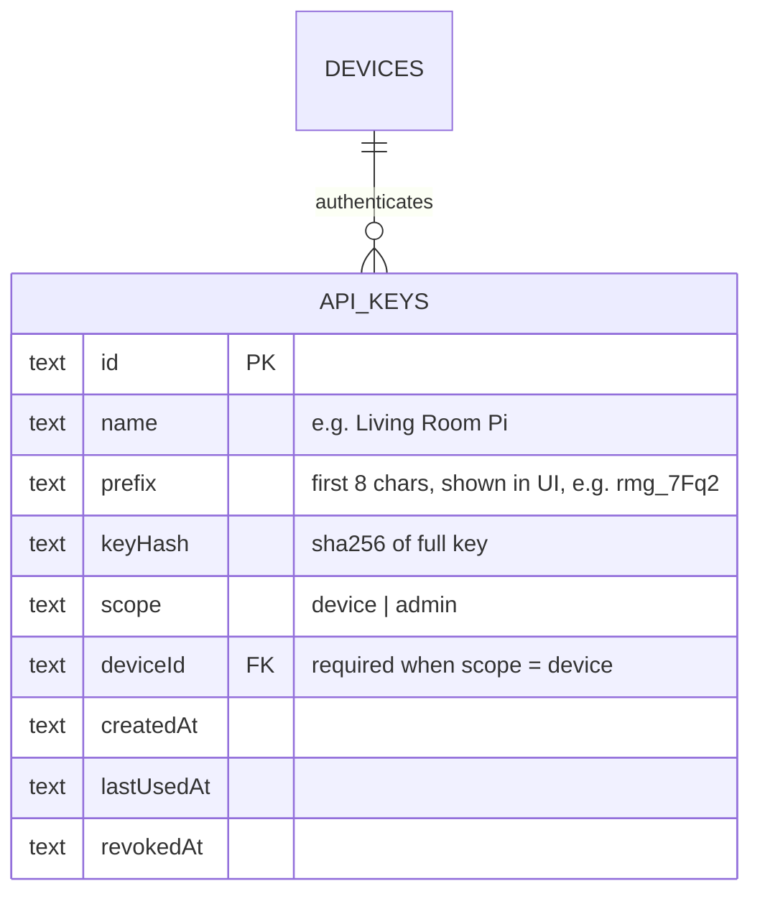
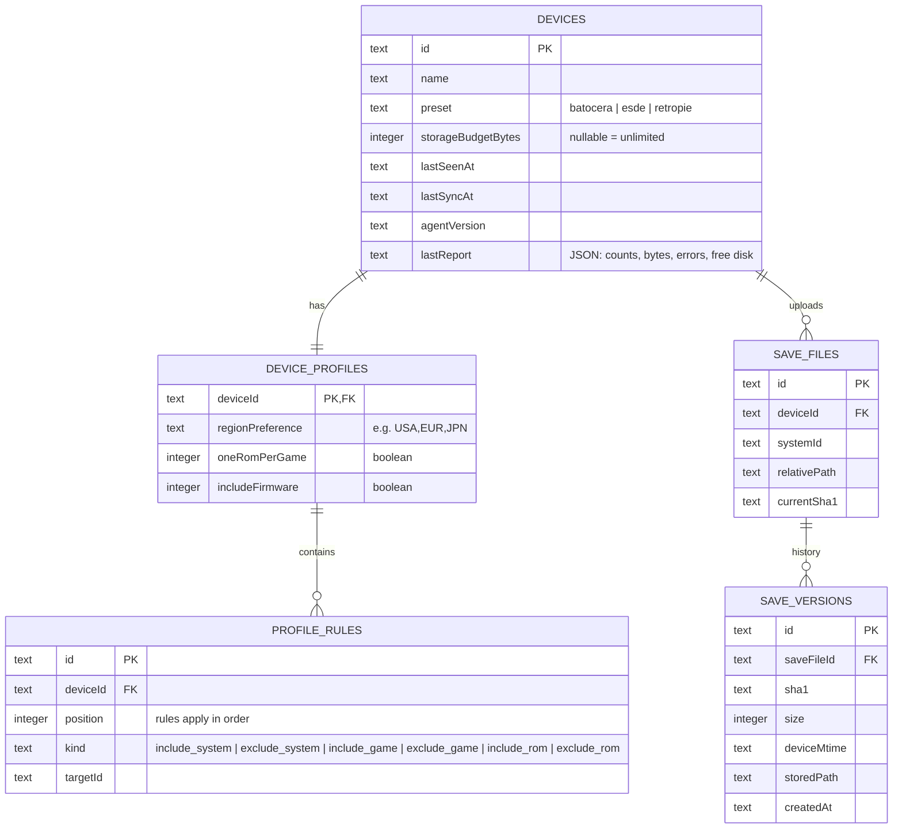
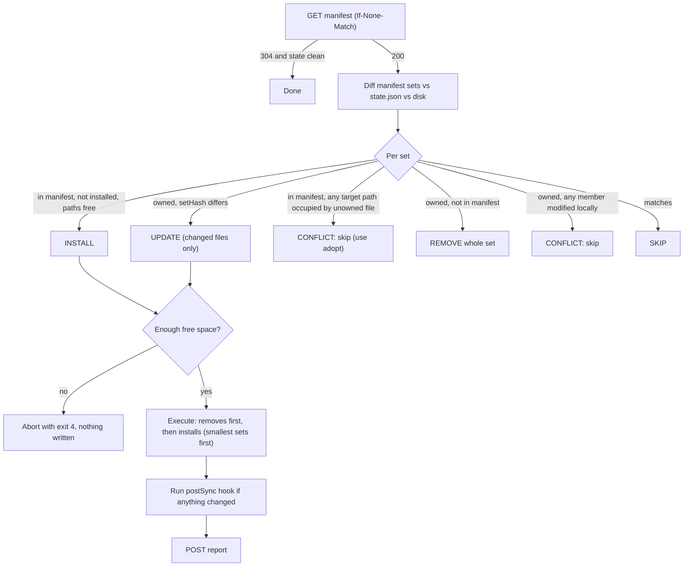
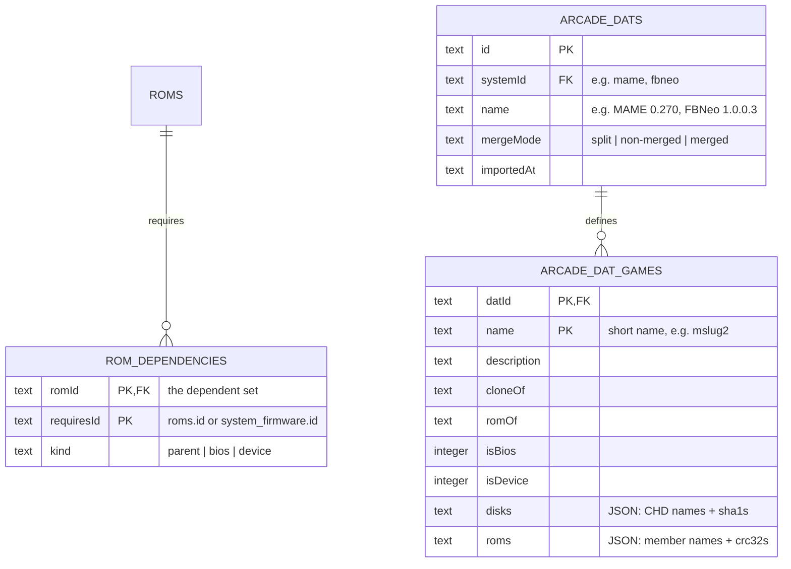

# Companion CLI — `romanager-sync`

> Status: **IMPLEMENTED (v1.0)** — Fully implemented in `apps/cli`, `apps/api`, and `apps/ui`.
>
> **v0.3 changes:** UI/WebDAV auth is out of scope (self-hosted only). The device mirrors the server's folder
> structure exactly. Arcade dependency sets are scheduled for **v1.1** (§12), and v1 ships a forward-compatible
> `requires` field.
>
> **v0.2 changes:** added API-key auth, made ROM sets (multi-file games) a core part of the model,
> removed gamelist.xml/media generation (EmulationStation / Batocera scrapers already handle this),
> and dropped armv7.

A small agent that runs **on the machine running EmulationStation / Batocera** and keeps that
device's local ROM collection in sync with a Romanager server.

---

## 1. Goals & Non-Goals

### Goals (v1)
- **Server → device**: ROM sets and BIOS/firmware, according to a **per-device profile** managed on the server.
- **First-class ROM sets**: multi-file games (`.cue`+`.bin`, `.gdi`+tracks, `.m3u` multi-disc, directory-based
  games) sync, verify and delete as one unit. A device never sees half a game.
- **Device → server**: save files (`.srm`, `.sav`, …) and save states, backed up with version history.
- **Live sync**: a `watch` (daemon) mode that listens to the server's event stream and syncs on change.
- **Authenticated**: every companion request carries a device-scoped API key.
- **Safe by default**: never touches files it didn't put there; resumable, verified, atomic installs.
- Single self-contained binary, no runtime install on the device.

### Non-Goals (v1)
- **gamelist.xml / artwork generation.** The frontend's own scraper owns metadata. The agent only puts files in place
  and (optionally) asks ES to rescan.
- Batocera service integration (auto-start on boot). Users can run `watch` from their own init script.
- On-device UI (ES notifications, ES menu entry).
- Uploading ROMs *from* the device into the library.
- Cross-device save **sync** (v1 is backup + explicit restore).
- 32-bit ARM (armv7) devices.
- Auth for the web UI or WebDAV. Romanager is self-hosted on a trusted network, and only the companion routes are key-protected.
- Device-specific folder layouts or transforms. The device mirrors the server's structure as-is.
- Arcade parent/clone/BIOS dependency resolution. This is planned for **v1.1** (§12).

---

## 2. Architecture Overview



### Location & runtime
- New workspace member: **`apps/cli`**, written in Deno/TypeScript, reusing `packages/shared` (Zod schemas
  become the API contract shared between server and agent).
- Released as `deno compile` binaries for `x86_64-unknown-linux-gnu` and `aarch64-unknown-linux-gnu`
  (PC Batocera, Steam Deck, Pi 4/5, modern ARM handhelds/SBCs).
- No dependencies beyond the Deno std lib + Zod. HTTP via `fetch`, SSE via a small hand-rolled parser
  (needed anyway so it can send the `Authorization` header, which `EventSource` can't).

---

## 3. Frontend Presets

The agent needs to know where things live. `init` auto-detects and writes a preset into the config.

| Path           | Batocera                       | ES-DE (Linux desktop)              | RetroPie                       |
| :------------- | :----------------------------- | :--------------------------------- | :----------------------------- |
| ROM root       | `/userdata/roms/<system>/`     | `~/ROMs/<system>/`                 | `~/RetroPie/roms/<system>/`    |
| BIOS           | `/userdata/bios/`              | `~/.config/retroarch/system/`      | `~/RetroPie/BIOS/`             |
| Saves          | `/userdata/saves/<system>/`    | RetroArch saves dir                | alongside ROMs / RetroArch dir |
| Config / state | `/userdata/system/romanager/`  | `~/.config/romanager/`             | `~/.config/romanager/`         |
| Post-sync hook | `curl -s localhost:1234/reloadgames` | none                         | none                           |

**v1 targets Batocera.** The other presets exist so the path abstraction is right from day one.

---

## 4. ROM Sets

This is the core data-model change, and it affects the scanner, import, the library UI and sync.

### 4.1 Concept
A **ROM** (the `roms` row) becomes a *logical* unit, a **set** of one or more physical files. Everything that
references a ROM (game mapping, device profiles, manifests, deletion) works on the set. Files only matter for
storage, hashing and transfer.

| Set type    | Example                                              | Launch file (what ES sees)         |
| :---------- | :--------------------------------------------------- | :--------------------------------- |
| `single`    | `Super Mario World (USA).sfc`, `game.zip`, `game.chd` | the file itself                   |
| `cue`       | `FF7 (Disc 1).cue` + `FF7 (Disc 1).bin`              | `.cue`                             |
| `gdi`       | `Shenmue.gdi` + `track01.bin` … `track03.raw`        | `.gdi`                             |
| `m3u`       | `FF7.m3u` + 3× (`.cue`+`.bin`) or 3× `.chd`          | `.m3u`                             |
| `directory` | `Demon's Souls.ps3/`, `Doom.pc/`, `MonkeyIsland.scummvm/` | the directory                 |

Nesting is resolved by flattening: an `m3u` set owns every file that its referenced `.cue`/`.chd` files need.

### 4.2 Schema



- `roms.path`, `roms.filename`, `roms.size` and the per-file hash columns move to `rom_files`. **Migration:** every existing
  ROM becomes a `single` set with one `rom_files` row (`role = launch`).
- `rom_files.relPath` + `roms.basePath` is unique, so one physical file belongs to exactly one set.
- `setHash` is the set's identity for sync. If any member file changes, the set changes.
- Firmware stays single-file (`system_firmware`), but gets `sha1` + `updatedAt`.

### 4.3 Scanner: set detection
The scanner currently stages each whitelisted file on its own. It gains a **grouping pass** per directory, after the walk:

1. **Directory sets**: any directory whose name ends in a configured "directory-game" extension
   (`.ps3`, `.pc`, `.scummvm`, `.wiiu`, `.squashfs`-style; stored in `file_type_whitelist` as `kind = directory`)
   is staged as one `directory` set. The walk does not descend into it for further grouping.
2. **Descriptor parsing**: parse `.m3u` → referenced entries, `.cue` → `FILE "…"` lines, `.gdi` → track lines.
   Reference resolution is relative to the descriptor and **case-insensitive** (dumps are often inconsistent about case).
3. **Claiming**: process `m3u` first, then `gdi`/`cue`, then leftovers. Each descriptor claims its referenced files.
   A file claimed by an `m3u` set cannot also be its own `cue` set.
4. **Leftovers**: unclaimed whitelisted files become `single` sets. Unclaimed `.bin`/`.raw`/track files that *look*
   like set members (no matching descriptor) are staged as `single` with a warning flag for triage.
5. **Incomplete sets**: a missing referenced file marks the set `incomplete`. Incomplete sets can be imported,
   but they are **never included in a device manifest**, and they're flagged in the UI.
6. **Hashing**: sha1/md5/crc32 for every member file, hashed in the worker. Re-hash only when size/mtime change.

`scanned_files` mirrors this: a staged item is a set (`scanned_sets` + `scanned_set_files`), so the Unmapped
triage UI shows *"Final Fantasy VII (USA) — m3u, 7 files, 1.9 GB"* instead of seven rows.

### 4.4 Import, deletion and UI impact
- `POST /api/import` takes `scannedSetIds` and creates `roms` + `rom_files` in a single transaction.
- Deleting a ROM deletes **all member files**. The deletion worker gets the full path list, and the DB row is removed
  only after every file is gone (or already missing).
- WebDAV and the in-browser emulator resolve via `launchFile`.
- Game detail shows each set with an expandable file list, set type, total size and completeness.

### 4.5 Sync semantics for sets
- **Unit of work = set.** It is planned, transferred, verified, installed and removed as a whole.
- **Atomic install**: all files are downloaded to staging, then verified, then moved into place with the **launch file (or directory)
  last**. ES never sees a launch file whose tracks aren't there yet. See 7.2.
- **Layout on device** mirrors the server's folder structure **exactly**, relative to the system folder:
  `<deviceRomRoot>/<esFolder>/<setRelDir>/<relPath>`. There are no per-preset transforms, renames or generated files.
  The server is the single source of truth for layout: users organize sets there (e.g. discs in a subfolder next to
  an `.m3u`) and every device gets the same structure.
- **Change detection**: compare `setHash`. If it differs, re-download only the member files whose sha1 changed.
- **Partial removal never happens**: if any member file was modified locally, the whole set becomes a conflict.

---

## 5. Authentication (API Keys)

### 5.1 Model



- Key format: `rmg_` + 32 random bytes, base62. The full key is shown **once** at creation and never stored in plain text.
- Lookup: `prefix` → candidate row(s), then a constant-time compare of `sha256(key)` against `keyHash`.
- Transport: `Authorization: Bearer rmg_…`. Keys are never accepted in query strings, so they can't leak into logs.
- `lastUsedAt` is updated at most once a minute per key, to avoid write amplification.

### 5.2 Scopes
| Scope    | Access |
| :------- | :----- |
| `device` | Only its own device: `GET` manifest, `GET` content for files **in its current manifest**, its own event stream, its own saves, `POST` report. Nothing else. |
| `admin`  | Everything, including key and device management. For scripting/automation. |

### 5.3 Enforcement
- The auth middleware is mounted on the **device-facing** companion routes only (`/api/devices/me/*`, `/api/sync/*`).
  These routes refuse unauthenticated requests.
- The web UI, the admin device/key management routes and WebDAV stay **unauthenticated**. Romanager is self-hosted on a
  trusted network, and UI login is out of scope.
- The point of keys is device **identity and isolation**: each device only sees its own manifest, files and saves,
  and a lost or retired device can be revoked. They are not there to protect the server from the LAN.

### 5.4 Enrollment flow
1. In the UI: **Devices → Add device** → enter a name and preset. The server creates the `devices` row plus a `device`-scoped key,
   and shows the key once along with a ready-to-paste command:
   `romanager-sync init --server http://romanager.local:8000 --key rmg_…`
2. `init` calls `GET /api/devices/me` to confirm the key and fetch its device ID/profile, then writes the config.
   The key is stored in `config.json` with file mode `0600`.
3. Revoking a key in the UI cuts the device off immediately. The next request returns `401` and the CLI exits with code `6`.
   `romanager-sync auth set-key <key>` replaces it.

---

## 6. Server-Side Changes Required (Phase 0)

### 6.1 System → frontend folder mapping
System IDs today are RAWG platform IDs (e.g. `"79"`); ES expects folder names (`snes`, `megadrive`, `psx`).
- Add `systems.esFolder` (nullable) and ship a default RAWG → Batocera mapping table. Editable per system in the UI.
- Systems with no `esFolder` are left out of manifests and listed in `warnings` and in `doctor`.

### 6.2 Devices & profiles



**Profile resolution** (server-side, deterministic):
1. Candidate sets = all `complete` ROM sets in systems that have an `esFolder`.
2. Apply rules in `position` order. With no include rules, everything is included by default.
3. If `oneRomPerGame`: keep one set per (game, system), chosen by `regionPreference`, then smallest `totalSize`.
4. Add firmware for every included system if `includeFirmware`.
5. If the total exceeds `storageBudgetBytes`: truncate deterministically (rule order, then name) and set `overBudget: true`.

### 6.3 Endpoints

**Admin (UI) — open for now, admin-key capable:**

| Method & path                                    | Purpose |
| :----------------------------------------------- | :------ |
| `GET/POST /api/devices` · `GET/PATCH/DELETE /api/devices/:id` | Device CRUD and profile editing. `POST` also issues the first key. |
| `PUT /api/devices/:id/rules`                     | Replace profile rules. |
| `GET /api/devices/:id/manifest/preview`          | Resolved manifest + size totals, for the profile editor. |
| `GET/POST /api/keys` · `DELETE /api/keys/:id`    | List / create / revoke keys. |

**Companion (device key required):**

| Method & path                          | Purpose |
| :------------------------------------- | :------ |
| `GET /api/devices/me`                  | Identity check: device, profile summary, server version. |
| `GET /api/devices/me/manifest`         | Resolved desired state (6.4). `ETag` / `If-None-Match` → `304`. |
| `GET /api/devices/me/events`           | SSE: `manifest-changed`, `ping`. |
| `POST /api/devices/me/report`          | Heartbeat + sync result. |
| `GET /api/sync/files/:fileId`          | Stream one ROM member file or firmware file. Supports `Range`, `ETag` (sha1), `Content-Length`. `403` if the file isn't in this device's manifest. |
| `GET /api/devices/me/saves`            | List saves for this device. |
| `PUT /api/devices/me/saves/*path`      | Upload a save (`X-Sha1`, `X-Mtime`). No-op if the sha1 matches the current version. |
| `GET /api/devices/me/saves/*path?version=` | Download latest or a specific version. |

Transfer happens **per file**, not per set, so Range resume works on each multi-GB disc image independently.

### 6.4 Manifest shape (add to `packages/shared`)

```ts
export const ManifestFileSchema = z.object({
  id: z.string(),                  // rom_files.id or firmware id; used with /api/sync/files/:id
  path: z.string(),                // device-relative POSIX path from the ROM root (or BIOS root for firmware)
  size: z.number(),
  sha1: z.string(),
  role: z.enum(["launch", "track", "disc", "descriptor", "aux"]),
});

export const ManifestSetSchema = z.object({
  kind: z.enum(["rom", "firmware"]),
  id: z.string(),                  // roms.id / firmware id
  gameId: z.string().nullable(),
  systemId: z.string(),
  esFolder: z.string(),
  name: z.string(),
  setType: z.enum(["single", "cue", "gdi", "m3u", "directory"]),
  launchPath: z.string(),          // device-relative path ES will show
  setHash: z.string(),
  totalSize: z.number(),
  files: z.array(ManifestFileSchema).min(1),
  requires: z.array(z.string()).default([]), // ids of other sets this one depends on. Always [] in v1, used by v1.1 (§12)
  implicit: z.boolean().default(false),       // true = only included to satisfy another set's `requires`
});

export const ManifestSchema = z.object({
  deviceId: z.string(),
  version: z.string(),             // hash over all setHashes; also the ETag
  generatedAt: z.string(),
  overBudget: z.boolean(),
  totalBytes: z.number(),
  sets: z.array(ManifestSetSchema),
  warnings: z.array(z.string()),   // unmapped systems, path collisions, excluded incomplete sets…
});
```

The manifest never contains absolute server paths. Path collisions (two sets resolving to the same device path)
are de-duplicated deterministically and reported in `warnings`.

### 6.5 Events
The server emits `manifest-changed` on a device's stream when an import, delete, set change or profile edit could
affect that device's manifest (debounced ~2s). In v1 it's acceptable to fan this out to every device on any library change.
Events are only **hints**: the agent always re-fetches with `If-None-Match`.

---

## 7. CLI Design

### 7.1 Commands

```
romanager-sync init --server URL --key KEY [--preset batocera|esde|retropie]
    Verify the key, detect the preset, write the config (0600).

romanager-sync status
    Server/auth reachability, device and profile summary, last sync, pending changes, free disk.

romanager-sync sync [--dry-run] [--only roms|bios|saves] [--system <esFolder>]
    One-shot reconcile.

romanager-sync plan
    Alias for `sync --dry-run`. Lists sets to add, update and remove, plus conflicts, with sizes.

romanager-sync watch [--poll 15m]
    Daemon: sync once, then sync on manifest-changed events or when save files change.

romanager-sync adopt [--system X] [--dry-run]
    Take ownership of existing local sets whose every member file matches by sha1.

romanager-sync saves push [--system X]
romanager-sync saves list [--system X]
romanager-sync saves restore <path> [--version V] [--force]

romanager-sync auth set-key <key>
romanager-sync doctor
    Check paths, permissions, free space, auth, clock skew, unmapped-system warnings and leftover staging dirs.

romanager-sync config get|set <key> [value]
```

Global flags: `--config <path>`, `--json`, `-v/--verbose`, `-q/--quiet`.

Exit codes: `0` ok · `1` generic error · `2` partial sync · `3` server unreachable ·
`4` insufficient disk space · `5` config error · `6` auth rejected (401/403).

### 7.2 Config (`config.json`, mode 0600)

```jsonc
{
  "server": "http://romanager.local:8000",
  "apiKey": "rmg_…",
  "deviceId": "0b7c…",             // returned by /api/devices/me
  "preset": "batocera",
  "paths": {
    "roms": "/userdata/roms",
    "bios": "/userdata/bios",
    "saves": "/userdata/saves"
  },
  "sync": {
    "concurrency": 2,              // parallel file downloads
    "deleteMode": "trash",         // "trash" | "delete" | "never"
    "trashRetentionDays": 14,
    "minFreeBytes": 1073741824,
    "bandwidthLimitKbps": null
  },
  "saves": {
    "enabled": true,
    "include": ["*.srm", "*.sav", "*.state*", "*.mcd", "*.mcr"],
    "debounceSeconds": 30
  },
  "hooks": {
    "postSync": "curl -s http://localhost:1234/reloadgames"   // preset default; runs only if something changed
  }
}
```

### 7.3 Local state (`state.json`)
This is the record of **what the agent owns**, keyed by set. It is written atomically after each set completes.

```jsonc
{
  "schema": 1,
  "manifestVersion": "a1b2…",
  "sets": {
    "rom:7f3c…": {
      "kind": "rom",
      "setHash": "…",
      "requires": [],              // persisted so ref-counted removal works offline (§12.4)
      "launchPath": "psx/Final Fantasy VII (USA)/Final Fantasy VII (USA).m3u",
      "files": {
        "psx/Final Fantasy VII (USA)/Final Fantasy VII (USA).m3u":  { "sha1": "…", "size": 120,       "mtime": 1727999999000 },
        "psx/Final Fantasy VII (USA)/Final Fantasy VII (USA) (Disc 1).chd": { "sha1": "…", "size": 512000000, "mtime": 1727999999000 }
      },
      "syncedAt": "2026-10-04T11:00:00Z"
    }
  },
  "saves": { "psx/Final Fantasy VII (USA).srm": { "sha1": "…", "mtime": 1728000000000, "pushedAt": "…" } }
}
```

---

## 8. Sync Algorithm

### 8.1 Reconcile



**Disk change detection**: size + mtime against `state.json` first. Hash only on mismatch.

### 8.2 Set install pipeline
1. **Stage**: create `<romRoot>/.romanager-staging/<setId>/` (on the same filesystem, so the final move is a rename).
2. **Fetch files** (up to `concurrency` in parallel): stream each to `<staging>/<relPath>.part`, resuming with `Range`
   if a partial exists. Verify sha1 while streaming, retry up to 3× on mismatch, then rename to the final name inside staging.
   For an **update**, unchanged member files are hard-linked (falling back to copy) from the installed location into staging.
3. **Verify set**: every file in the manifest is present with the right size and sha1.
4. **Commit**:
   - `directory` sets: rename the staged directory into place in a single step (for an update: rename the old one aside, rename the new one in, then trash the old one).
   - Other sets: move non-launch files into place first, then **the launch file last**.
5. **Record**: write the set to `state.json`, then delete the staging dir.
6. **Crash recovery**: on startup, a staging dir whose set isn't in `state.json` is either resumed (if it's still in the manifest) or cleaned up.
   Files already moved into place by an interrupted commit are recognised by sha1 and claimed.

### 8.3 Removal
- Only for sets in `state.json` whose member files still match their recorded sha1.
- `trash` mode moves the whole set to `<romRoot>/.romanager-trash/<date>/<setId>/` and purges it after `trashRetentionDays`.
- The **launch file is removed first**, so ES stops listing the game before its tracks disappear. Then the other files go, then
  any directories left empty that the agent created.

### 8.4 Space, locking
- `needed = Σ(bytes to fetch) − Σ(bytes removed)`, plus staging headroom for the largest single set being updated.
  Abort before any writes if `free − needed < minFreeBytes`.
- A lock file (`<configDir>/sync.lock` with PID) stops `watch` and a manual `sync` from running at the same time.

### 8.5 Ownership rules (the safety contract)
- The agent **only modifies or deletes paths recorded in `state.json`**.
- If a target path is occupied by an unowned file, the set is a conflict. The agent never overwrites it.
- `adopt` claims an existing local set only if **every** member file matches by path and sha1. A partial match
  is reported, not adopted.
- Locally modified owned files turn their set into a conflict: no update, no removal.

### 8.6 Saves (device → server)
- Scan `paths.saves` (plus ROM dirs for emulators that save next to the ROM) using the `saves.include` globs.
- `watch` uses `Deno.watchFs` with a per-file debounce (`saves.debounceSeconds`).
- Upload when the sha1 differs from state. The server keeps the last N distinct versions (default 10).
- `saves restore` refuses to overwrite a newer local file without `--force` and always keeps a `<file>.bak`.

### 8.7 Watch mode
- One SSE connection to `/api/devices/me/events` with the bearer key. A `manifest-changed` event triggers a sync,
  coalesced and at least 10s apart.
- Fallback poll every `--poll` (default 15m), using `If-None-Match`.
- Reconnect backoff 1s → 5m cap with jitter. A `401` stops the daemon with exit code `6` (no reconnect storm).
- `SIGTERM`/`SIGINT`: finish the current file, persist state, release the lock, exit `0`.
- Heartbeat `report` every 5 minutes.

---

## 9. Server UI Additions (`apps/ui`)
- **Devices page** (`/devices`): online/offline status, last sync, bytes on device vs budget, last report errors, **Add device** (shows the key once).
- **Device detail** (`/devices/:id`): profile editor with a live manifest preview and totals, key management (rotate/revoke), and a saves browser with version history.
- **Unmapped triage**: staged items shown as sets, with type, file count, size and an incomplete warning.
- **Game detail**: ROM sets with expandable file lists, plus "On devices" badges and add/remove-from-device actions.
- **Platform settings**: an `esFolder` field per system.

---

## 10. Delivery Phases

| Phase | Scope | Exit criteria |
| :---- | :---- | :------------ |
| **0a: ROM sets** | `rom_files` schema + migration, scanner grouping pass (m3u/cue/gdi/directory), per-file hashing, set-aware import/deletion/WebDAV/UI | Test fixtures for every set type (incl. case-mismatched cue refs, nested m3u→cue, missing track → incomplete) |
| **0b: Auth + devices** | `api_keys`, middleware, devices/profiles/rules, `esFolder` mapping, manifest + preview, `/api/sync/files/:id` with Range/ETag, device SSE stream | API tests: key scope isolation (device A can't fetch device B's files), profile resolution, 304, Range resume |
| **1: One-shot sync** | `apps/cli`: `init`/`status`/`plan`/`sync`/`adopt`/`doctor`/`auth`, set install/update/remove, trash, lock, crash recovery, post-sync hook, compiled binaries | On a clean Batocera box a mixed profile (single + cue + m3u multi-disc + directory set) syncs and ES shows each multi-file game once. Killing the agent mid-set never leaves a visible launch file without its tracks. Unowned files are never touched |
| **2: Watch mode + UI** | SSE client, poll fallback, heartbeat, Devices UI + profile editor | Importing a set on the server shows up on the device within ~30s, hands-off |
| **3: Saves** | Save endpoints + versioned storage, `saves push/list/restore`, watchFs uploader, saves UI | Saves upload within the debounce window and can be restored from the UI and CLI |
| **v1.1: Arcade sets** | DAT import, arcade set detection, `rom_dependencies`, dependency closure in profile resolution, dependency-ordered install and ref-counted removal in the agent (§12) | Adding a single Neo Geo clone to a profile installs the clone, its parent and `neogeo.zip`. Removing it removes only what nothing else needs, and the game launches on Batocera |

> [!NOTE]
> To keep v1.1 a non-breaking upgrade, the **v1 agent already handles** `requires` (topological install order and
> ref-counted removal) even though the v1 server always sends `[]`. The v1.1 work in the agent is then limited to UI/plan
> output, rather than a change to the sync algorithm.

---

## 11. Risks & Open Questions

1. **RAWG → ES folder mapping.** Some RAWG platforms map to several ES systems (Arcade → `mame`/`fbneo`/`neogeo`).
   The default table covers the obvious cases. Per-system override is mandatory, and per-ROM override may be needed for
   arcade. Revisit in v1.1.
2. **Clock skew** affects save mtime comparisons. sha1 comes first, mtime is only a tiebreaker, and `doctor` warns if skew is over 5 minutes.
3. **Binary size.** `deno compile` output is about 80–100 MB. Fine on the target hardware, but worth tracking.

### Decided
| Topic | Decision |
| :---- | :------- |
| UI / WebDAV auth | Out of scope. Self-hosted only; API keys protect device-facing routes only. |
| Device folder layout | Mirror the server's folder structure exactly. No transforms. |
| Arcade dependency sets | Not in v1 (arcade zips sync as `single`); in scope for **v1.1**. |
| gamelist.xml / media | Out of scope. The frontend's scraper handles it. |
| armv7 | Not supported. |

---

## 12. v1.1: Arcade ROM Sets

Arcade games (MAME, FBNeo, Neo Geo, Naomi/Atomiswave) aren't self-contained. A game zip may need its **parent**
zip (clone → parent), a **BIOS** zip (`neogeo.zip`, `naomi.zip`, `pgm.zip`), **device** zips, and a **CHD** folder.
Without those, the game won't launch. v1.1 models these as dependency edges between sets.

### 12.1 Schema additions



- New set type **`arcade`**: one zip (or 7z) plus an optional CHD directory named after the game (`<system>/<shortname>/*.chd`,
  the MAME convention). Both are members of the same set, so this fits the existing `rom_files` model.
- BIOS and device zips are imported as `arcade` sets flagged `isBios`/`isDevice`. They are hidden from the game library and
  never mapped to a `game`.

### 12.2 Detection & import
1. The user imports a **DAT** (MAME/FBNeo XML or Logiqx) per arcade system, from settings.
2. The scanner matches zips by **short name**, then verifies them by comparing the **CRC32s in the zip's central directory**
   against the DAT (no extraction, so it's fast even on large romsets). The result is per-set status: `complete`, `incomplete`
   (missing members) or `unknown` (not in the DAT).
3. Dependency edges come from `cloneof` / `romof` / BIOS / device references, **adjusted for merge mode**:
   - `non-merged`: zips are self-contained, so only `bios`/`device` edges apply.
   - `split`: clone → parent edges plus `bios`/`device` edges.
   - `merged`: clones live inside the parent zip, so the clone maps to the parent set itself (no separate install unit).
4. CHDs are matched by sha1 from the DAT's `<disk>` entries.
5. Game naming uses the DAT `description` (e.g. *"Metal Slug 2 - Super Vehicle-001/II"*), which also feeds RAWG matching.

### 12.3 Profile resolution
- After the rules in §6.2 run, the server computes the **transitive closure** of `requires` for every selected set.
- Sets added only through the closure are emitted with `implicit: true`. They count toward the storage budget, show up
  in the profile preview as "required by N games", and can't be excluded on their own (excluding one excludes its dependents too, with a warning).
- Firmware dependencies (e.g. a BIOS the system expects under `/userdata/bios`) use the same mechanism, through `requiresId`
  pointing at a `system_firmware` row.
- A set whose closure contains an `incomplete` or missing dependency is left out, with a warning naming the missing piece.

### 12.4 Agent behaviour (implemented in v1, exercised in v1.1)
- **Install order**: topological, so dependencies are installed and committed before their dependents. A clone's launch
  file never appears before its parent/BIOS is in place.
- **Ref-counted removal**: a set is removed only when it's no longer in the manifest **and** no installed set lists it in
  `requires`. Removal runs in reverse topological order.
- **Cycle guard**: the agent refuses a manifest with a dependency cycle (exit `5`) instead of looping. The server validates this too.
- **Plan output** groups implicit sets under their dependents, for example `+ mslug2 (requires: neogeo [bios], already installed)`.

### 12.5 Open questions for v1.1
- Is DAT import manual (upload) or automatic (fetch a known DAT version per emulator core)?
- Batocera puts `neogeo.zip` in `roms/neogeo/` **or** `bios/`. Do we treat it as a ROM-folder BIOS set (current proposal)
  or as firmware? Placement may differ by core.
- Rebuilding sets (converting between merge modes) is explicitly **out of scope**. Romanager reads sets as they are;
  tools like RomVault/ClrMamePro handle rebuilding.
