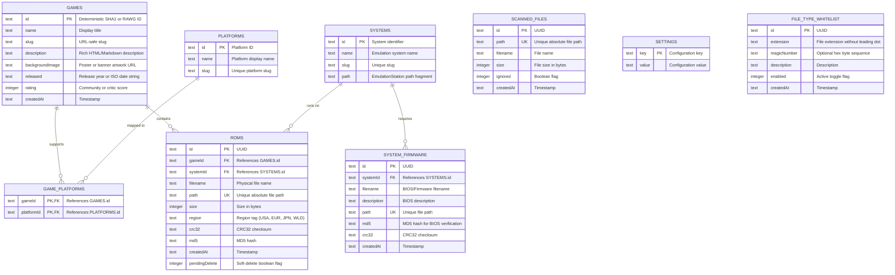

# Database Schema

Romanager uses [Drizzle ORM](https://orm.drizzle.team/) running over SQLite / [LibSQL](https://github.com/tursodatabase/libsql). Schema definitions are located in [`apps/api/src/db/schema.ts`](../apps/api/src/db/schema.ts).

---

## Entity-Relationship (ER) Diagram

---

## Table Definitions

### 1. `games`
Represents a canonical game title in the user's catalog.

| Column | Type | Constraints | Description |
| :--- | :--- | :--- | :--- |
| `id` | `text` | `PRIMARY KEY` | Deterministic SHA1 hash (e.g. `game:<slug>`) or RAWG ID |
| `name` | `text` | `NOT NULL` | Game title |
| `slug` | `text` | `NOT NULL` | URL-safe slug |
| `description` | `text` | `NULL` | Game summary from RAWG or user |
| `background_image` | `text` | `NULL` | Artwork URL |
| `released` | `text` | `NULL` | Release date / year |
| `rating` | `integer` | `NULL` | Game rating score |
| `created_at` | `text` | `NOT NULL DEFAULT CURRENT_TIMESTAMP` | Creation timestamp |

---

### 2. `platforms`
Represents an emulation platform / video game console.

| Column | Type | Constraints | Description |
| :--- | :--- | :--- | :--- |
| `id` | `text` | `PRIMARY KEY` | Platform ID |
| `name` | `text` | `NOT NULL` | Platform display name |
| `slug` | `text` | `NOT NULL UNIQUE` | Unique platform slug |

---

### 3. `game_platforms`
Composite junction table connecting Games to Platforms.

| Column | Type | Constraints | Description |
| :--- | :--- | :--- | :--- |
| `game_id` | `text` | `NOT NULL REFERENCES games(id)` | Associated game |
| `platform_id` | `text` | `NOT NULL REFERENCES platforms(id)` | Associated platform |

- **Primary Key**: `(game_id, platform_id)`

---

### 4. `systems`
Emulation system definitions used for directory routing and BIOS mapping.

| Column | Type | Constraints | Description |
| :--- | :--- | :--- | :--- |
| `id` | `text` | `PRIMARY KEY` | System ID |
| `name` | `text` | `NOT NULL` | System display name |
| `slug` | `text` | `NOT NULL UNIQUE` | System slug |
| `path` | `text` | `NULL` | EmulationStation core path fragment |

---

### 5. `roms`
Individual physical ROM files linked to a game and system.

| Column | Type | Constraints | Description |
| :--- | :--- | :--- | :--- |
| `id` | `text` | `PRIMARY KEY` | Unique ROM UUID |
| `game_id` | `text` | `REFERENCES games(id)` | Canonical game |
| `system_id` | `text` | `REFERENCES systems(id)` | Associated system |
| `filename` | `text` | `NOT NULL` | ROM file name on disk |
| `path` | `text` | `NOT NULL UNIQUE` | Absolute filesystem path |
| `size` | `integer` | `NOT NULL` | File size in bytes |
| `region` | `text` | `NULL` | Region tag (e.g. "USA", "EUR", "JPN") |
| `crc32` | `text` | `NULL` | CRC32 hash checksum |
| `md5` | `text` | `NULL` | MD5 checksum |
| `created_at` | `text` | `NOT NULL DEFAULT CURRENT_TIMESTAMP` | Timestamp |
| `pending_delete` | `integer` (boolean) | `NOT NULL DEFAULT 0` | Soft-delete flag for optimistic UI removal |

---

### 6. `system_firmware`
Stores firmware, BIOS, and OS files required by emulators.

| Column | Type | Constraints | Description |
| :--- | :--- | :--- | :--- |
| `id` | `text` | `PRIMARY KEY` | Firmware UUID |
| `system_id` | `text` | `NOT NULL REFERENCES systems(id)` | Target system |
| `filename` | `text` | `NOT NULL` | BIOS filename (e.g., `scph1001.bin`) |
| `description` | `text` | `NULL` | Human-readable note or version |
| `path` | `text` | `NOT NULL UNIQUE` | Absolute path on disk |
| `md5` | `text` | `NULL` | MD5 checksum for BIOS validation |
| `crc32` | `text` | `NULL` | CRC32 checksum |
| `created_at` | `text` | `NOT NULL DEFAULT CURRENT_TIMESTAMP` | Timestamp |

---

### 7. `scanned_files`
Staging area for files discovered during scanning passes that have not yet been imported or mapped.

| Column | Type | Constraints | Description |
| :--- | :--- | :--- | :--- |
| `id` | `text` | `PRIMARY KEY` | Staged file UUID |
| `path` | `text` | `NOT NULL UNIQUE` | File path on disk |
| `filename` | `text` | `NOT NULL` | Filename on disk |
| `size` | `integer` | `NOT NULL` | Size in bytes |
| `ignored` | `integer` (boolean) | `NOT NULL DEFAULT 0` | If `true`, hidden from triage list |
| `created_at` | `text` | `NOT NULL DEFAULT CURRENT_TIMESTAMP` | Timestamp |

---

### 8. `settings`
Key-value store for application configuration.

| Column | Type | Constraints | Description |
| :--- | :--- | :--- | :--- |
| `key` | `text` | `PRIMARY KEY` | Setting name (e.g. `roms_dir`) |
| `value` | `text` | `NOT NULL` | Setting value |

---

### 9. `file_type_whitelist`
Maintains the allowed ROM and BIOS file extensions and optional file header magic numbers.

| Column | Type | Constraints | Description |
| :--- | :--- | :--- | :--- |
| `id` | `text` | `PRIMARY KEY` | Whitelist rule UUID |
| `extension` | `text` | `NOT NULL` | File extension without leading dot (e.g. `sfc`, `nes`, `gba`) |
| `magic_number` | `text` | `NULL` | Optional hex byte signature (e.g. `4E45531A`) |
| `description` | `text` | `NULL` | Friendly format / console description |
| `enabled` | `integer` (boolean) | `NOT NULL DEFAULT 1` | Whether rule is actively enforced |
| `created_at` | `text` | `NOT NULL DEFAULT CURRENT_TIMESTAMP` | Creation timestamp |

---

## Migrations & Drizzle Kit

Migrations are managed through Drizzle Kit. Configuration is defined in [`apps/api/drizzle.config.ts`](../apps/api/drizzle.config.ts).

### Common Commands:
- `deno task db:generate` - Generates SQL migrations into `drizzle/`
- `deno task db:migrate` - Executes pending migration files
- `deno task db:push` - Synchronizes schema directly to the database without generating migration files (ideal for development)

