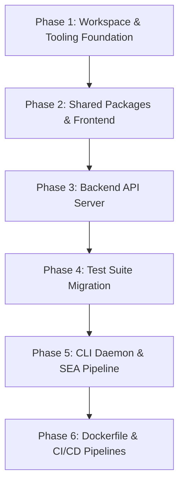

# Romanager: Deno to Node.js Migration Plan

This document outlines the detailed technical migration plan to move **Romanager** from the Deno runtime to a **Node.js LTS (v22+)** foundation, incorporating **Vite + Oxc** for the frontend and **Node.js Single Executable Applications (SEA)** for the companion CLI.

Refer to the associated Architecture Decision Records:
- [ADR 0001: Migrate Stack from Deno to Node.js](../adr/0001-migrate-from-deno-to-nodejs.md)
- [ADR 0002: CLI Standalone Binary Distribution via Node.js SEA](../adr/0002-cli-standalone-binaries-via-node-sea.md)
- [ADR 0003: Frontend Toolchain — Vite, Oxc, and TypeScript 7.0 Target](../adr/0003-frontend-toolchain-oxc-vite-ts7.md)

---

## 1. Architectural Mapping

| Layer / Concern | Current Deno Architecture | Target Node.js Architecture |
| :--- | :--- | :--- |
| **Workspace Manager** | `deno.json` workspaces (`apps/*`, `packages/*`) | `pnpm` workspaces (`pnpm-workspace.yaml`) |
| **Dependency Resolution** | `jsr:`, `npm:`, `file:` specifiers in `deno.json` | Standard `package.json` dependencies + npm registry |
| **TypeScript Runtime** | Deno runtime TS execution | Node 22+ / `tsx` for dev, `tsc` for type verification |
| **Backend Framework** | Hono with `Deno.serve()` | Hono with `@hono/node-server` |
| **Static File Serving** | `@hono/hono/serve-static` with Deno file handlers | `@hono/node-server/serve-static` / native stream handler |
| **Network Storage** | `@smallweb/webdav` (JSR / Deno std) | Node WebDAV server (`webdav-server` or Hono WebDAV mount) |
| **Background Workers** | Deno Web Workers (`new Worker(...)`) | `node:worker_threads` (or in-process async queues) |
| **Database & ORM** | Drizzle ORM + `@libsql/client` (SQLite) | Drizzle ORM + `@libsql/client` (unchanged) |
| **Frontend Framework** | Lit 3 + `@lit-labs/router` + `@lit/task` | Lit 3 (unchanged) |
| **Frontend Toolchain** | `rolldown-vite` + `@deno/vite-plugin` | **Vite** + **Oxc** (`oxlint`), targeting **TypeScript 7.0** |
| **CLI Companion Daemon** | `deno compile` cross-compilation matrix | **Node.js Single Executable Applications (SEA)** via `postject` |
| **Test Runner** | `deno test` with `@std/assert` | **Vitest** with JSDOM environment |
| **BDD E2E Tests** | `npm:playwright-bdd` run via Deno | Native Playwright BDD on Node.js |
| **Linting & Code Quality** | `deno lint` | **Oxc** (`oxlint`) |
| **Container Base** | `denoland/deno:2.1.4` | `node:22-bookworm-slim` |

---

## 2. Phased Implementation Roadmap



---

### Phase 1: Workspace & Tooling Foundation

**Objective**: Establish the `pnpm` monorepo configuration, TypeScript configurations, and Oxc linter.

1. **Create `pnpm-workspace.yaml`**:
   ```yaml
   packages:
     - "apps/*"
     - "packages/*"
   ```
2. **Root `package.json` Updates**:
   - Define root scripts matching existing Deno tasks:
     ```json
     {
       "scripts": {
         "dev": "pnpm --parallel --filter @romanager/ui --filter @romanager/api dev",
         "dev:api": "pnpm --filter @romanager/api dev",
         "dev:ui": "pnpm --filter @romanager/ui dev",
         "build": "pnpm --recursive run build",
         "build:ui": "pnpm --filter @romanager/ui build",
         "build:cli": "pnpm --filter @repo/cli build:sea",
         "test": "vitest run",
         "test:api": "vitest run tests/api",
         "test:unit": "vitest run tests/unit",
         "test:e2e": "playwright-bdd test && playwright test",
         "lint": "oxlint --deny-warnings",
         "typecheck": "tsc --build --noEmit"
       }
     }
     ```
3. **Configure TypeScript Target (TS 7.0 Architecture)**:
   - Create root `tsconfig.base.json`:
     ```json
     {
       "compilerOptions": {
         "target": "ES2024",
         "module": "NodeNext",
         "moduleResolution": "NodeNext",
         "strict": true,
         "esModuleInterop": true,
         "skipLibCheck": true,
         "experimentalDecorators": true,
         "useDefineForClassFields": false,
         "isolatedDeclarations": true
       }
     }
     ```
4. **Git Hooks & Linting**:
   - Install `oxlint` as a dev dependency.
   - Update [lefthook.yml](file:///home/michael/gits/Romanager/lefthook.yml) and [.lintstagedrc.json](file:///home/michael/gits/Romanager/.lintstagedrc.json) to run `npx oxlint` instead of `deno lint`.

---

### Phase 2: Shared Packages & Frontend (`apps/ui`, `packages/*`)

**Objective**: Migrate frontend and shared libraries to Vite, Oxc, and TypeScript 7.0 standards.

1. **`packages/shared`**:
   - Create `packages/shared/package.json` (`name: "@repo/shared"`).
   - Export Zod schemas, types, and utility functions using standard ESM exports.
   - Verified pure TypeScript — 0 runtime adjustments needed.
2. **`packages/ui-components`**:
   - Create `packages/ui-components/package.json` (`name: "@repo/ui-components"`).
   - Configure Lit 3 dependency and exports.
3. **`apps/ui` (Vite + Lit)**:
   - Create `apps/ui/package.json` (`name: "@romanager/ui"`).
   - Update `apps/ui/vite.config.ts`:
     - Remove `@deno/vite-plugin`.
     - Configure alias mapping for `@repo/shared` and `@repo/ui-components`.
     - Ensure Lit decorators transform properly.
   - Verify dev server: `pnpm --filter @romanager/ui dev`.
   - Verify production bundle: `pnpm --filter @romanager/ui build` $\rightarrow$ emits to `apps/ui/dist`.

---

### Phase 3: Backend API Server (`apps/api`)

**Objective**: Port Hono server and filesystem operations to Node.js built-ins.

1. **Dependencies**:
   - Install `@hono/node-server`, `@hono/hono`, `dotenv`, `drizzle-orm`, `@libsql/client`.
2. **Entry Point (`apps/api/main.ts`)**:
   - Replace `@std/dotenv` with native `process.loadEnvFile()` (or `dotenv`).
   - Replace `Deno.serve()` with `@hono/node-server`:
     ```ts
     import { serve } from "@hono/node-server";
     import createServer from "./src/app.ts";

     const PORT = Number(process.env.PORT) || 8000;
     const ROMS_DIR = process.env.ROMS_DIR || "./roms";
     const APP_DIR = process.env.APP_DIR || "./apps/ui/dist";

     const app = createServer(ROMS_DIR, APP_DIR);
     serve({ fetch: app.fetch, port: PORT });
     ```
3. **Filesystem API Modernization**:
   - Update `manifest.ts`, `scanner-sets.ts`, `set-parser.ts`, `hasher.ts`:
     - Replace `@std/path` $\rightarrow$ `node:path`.
     - Replace `@std/fs` (`ensureDir`, `walk`) $\rightarrow$ `node:fs/promises` (`mkdir({ recursive: true })`, `readdir({ recursive: true, withFileTypes: true })`).
     - Replace `Deno.stat()`, `Deno.readTextFile()`, `Deno.open()` with `node:fs/promises`.
4. **Range Request & Streaming in `sync.ts`**:
   - Replace manual `Deno.open` chunk pull loops with:
     ```ts
     import { createReadStream } from "node:fs";
     import { Readable } from "node:stream";

     const fileStream = createReadStream(filePath, { start, end });
     const webStream = Readable.toWeb(fileStream) as ReadableStream;
     ```
5. **WebDAV Mount**:
   - Replace `@smallweb/webdav` with a Node-compatible WebDAV server handler attached to `/webdav`.
6. **Workers**:
   - Update [scanner.ts](file:///home/michael/gits/Romanager/apps/api/src/workers/scanner.ts) and [deletion.worker.ts](file:///home/michael/gits/Romanager/apps/api/src/workers/deletion.worker.ts) to utilize `node:worker_threads` (`parentPort.on('message', ...)`, `parentPort.postMessage(...)`).

---

### Phase 4: Test Suite Migration

**Objective**: Migrate ~40 test files to Vitest and verify Playwright BDD execution.

1. **Install Vitest**:
   - Install `vitest`, `@vitest/coverage-v8`, `jsdom`.
   - Create root `vitest.config.ts`:
     ```ts
     import { defineConfig } from "vitest/config";

     export default defineConfig({
       test: {
         globals: true,
         environment: "node",
         include: ["tests/api/**/*.ts", "tests/unit/**/*.ts"],
         environmentMatchGlobs: [
           ["tests/unit/ui/**", "jsdom"],
         ],
       },
     });
     ```
2. **Convert Tests**:
   - For `tests/api/routes/*_test.ts`:
     - Replace `Deno.test(name, fn)` with `test(name, fn)`.
     - Replace `assertEquals`, `assertRejects`, `assert` with Vitest's `expect(...)` or `assert.*`.
3. **UI Unit Tests**:
   - In `tests/unit/ui/`: Lit web component tests run directly inside Vitest with `environment: "jsdom"`.
4. **Playwright BDD Tests**:
   - Run via standard npm scripts: `npx playwright-bdd test && npx playwright test`.

---

### Phase 5: Companion CLI & Node SEA Pipeline

**Objective**: Implement the Node SEA build pipeline for `romanager-sync`.

1. **Port CLI Runtime APIs**:
   - In `apps/cli/src`:
     - `Deno.args` $\rightarrow$ `process.argv.slice(2)`.
     - `Deno.exit` $\rightarrow$ `process.exit`.
     - `new Deno.Command("df")` $\rightarrow$ `node:child_process.execFile`.
     - `@std/cli/parse_args` $\rightarrow$ `node:util.parseArgs`.
     - Signal listeners $\rightarrow$ `process.on('SIGINT', ...)`.
2. **Create SEA Configuration**:
   - Create `apps/cli/sea-config.json`:
     ```json
     {
       "main": "apps/cli/dist/bundle.cjs",
       "output": "apps/cli/dist/sea-prep.blob",
       "disableExperimentalSEAWarning": true
     }
     ```
3. **Build Script (`scripts/build-cli-sea.ts`)**:
   - Bundles CLI with `rolldown` (unifying bundling on the Oxc Rust toolchain and eliminating `esbuild`).
   - Generates `sea-prep.blob` via `node --experimental-sea-config`.
   - Injects the blob into the target Node executable with `postject`.
4. **Cross-Compilation Matrix for Releases**:
   - Configure [.github/workflows/release.yml](file:///home/michael/gits/Romanager/.github/workflows/release.yml) to retrieve official Node binaries for `linux-x64`, `linux-arm64`, `darwin-x64`, `darwin-arm64`, and `win-x64`, inject the blob, sign macOS binaries, and output GitHub release assets.

---

### Phase 6: Dockerfile & CI/CD Pipelines

**Objective**: Overhaul container builds and GitHub Actions workflows.

1. **`Dockerfile` Update**:
   - Switch from `denoland/deno:2.1.4` to `node:22-bookworm-slim`.
   - Stage 1 (`ui-builder`): Installs pnpm, builds `apps/ui` static bundle.
   - Stage 2 (`runner`): Copies backend source, installed node_modules, and UI dist; runs `node apps/api/main.js` (or via `tsx`).
2. **`.github/workflows/ci.yml` Update**:
   - Remove Deno setup step.
   - Use `actions/setup-node@v4` with `pnpm` caching.
   - Run lint (`oxlint`), type check (`tsc`), unit/API tests (`vitest`), and E2E tests (`playwright`).
3. **`.github/workflows/release.yml` Update**:
   - Use the Node SEA matrix build defined in Phase 5.

---

## 3. Verification & Acceptance Checklist

Before declaring the migration complete, verify all quality gates:

- [ ] **Typecheck**: `pnpm run typecheck` passes with zero errors across all packages and apps.
- [ ] **Linter**: `pnpm run lint` (`oxlint`) passes with zero warnings.
- [ ] **API Contract Tests**: All 16 API route tests in `tests/api/routes` pass under Vitest.
- [ ] **UI Unit Tests**: All 15 Lit UI component tests pass in Vitest JSDOM environment.
- [ ] **Playwright BDD Tests**: All `.feature` scenarios pass via Playwright.
- [ ] **CLI Standalone Binaries**:
  - [ ] Linux x86_64 binary executes without Node installed: `./romanager-sync --help`
  - [ ] Linux ARM64 binary executes on target handheld OS (Batocera/Anbernic).
  - [ ] macOS Apple Silicon binary executes with valid ad-hoc signature.
  - [ ] Windows x64 binary executes cleanly.
- [ ] **Docker Container**: `docker build -t romanager:latest . && docker run -p 8000:8000 romanager:latest` starts up and serves the SPA and `/api/health`.
